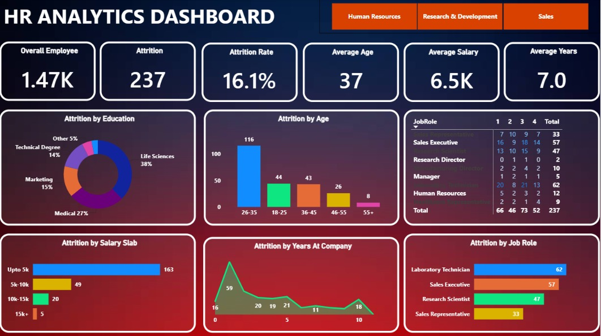

# 📊 HR Analytics Dashboard

An interactive **HR Analytics Dashboard built using Microsoft Power BI** to explore employee data, analyze workforce trends, and generate meaningful insights that support data-driven Human Resource (HR) decisions.

## 📌 Project Overview

The HR Analytics Dashboard transforms employee data into interactive visual reports, helping users understand workforce distribution and identify patterns related to employee attrition.

This project demonstrates the use of data visualization and business intelligence to present HR metrics in a clear and accessible format.

## 🎯 Objectives

- Analyze employee data to understand workforce composition.
- Explore employee attrition patterns and trends.
- Examine employee distribution across departments and job roles.
- Visualize HR metrics through interactive charts and reports.
- Support data-driven HR analysis and decision-making.

## 🛠️ Technologies Used

- **Microsoft Power BI** — Dashboard development and interactive visualizations.
- **CSV** — Employee dataset storage and input.
- **Data Visualization** — Charts, graphs, and KPI-based reporting.

## 📂 Repository Structure

```text
hr_analytics_dashboard/
│
├── Dashboard.jpeg
├── HR_Analytics.csv
├── HR_analytics_dasboard.pbix
└── README.md
```

| File | Description |
|---|---|
| `Dashboard.jpeg` | Dashboard screenshot for previewing the project. |
| `HR_Analytics.csv` | Employee dataset used for analysis. |
| `HR_analytics_dasboard.pbix` | Power BI dashboard file. |
| `README.md` | Project documentation. |

## 📈 Dashboard Preview



## ✨ Key Features

- **Interactive Visualizations:** Explore HR data through visual reports and charts.
- **Employee Analytics:** Understand employee distribution across relevant categories.
- **Attrition Analysis:** Examine employee attrition patterns to identify potential trends.
- **Department-Wise Insights:** Compare workforce metrics across departments.
- **Data-Driven Reporting:** Present HR information in a visual format that is easier to interpret.

## 📊 Key Areas of Analysis

The dashboard focuses on exploring HR data across areas such as:

- Employee demographics
- Department and job role distribution
- Employee attrition
- Workforce composition
- HR trends and performance-related indicators available in the dataset

## 🚀 How to Use the Project

1. Clone or download this repository.

   ```bash
   git clone https://github.com/Sakshi-Singh-17/hr_analytics_dashboard.git
   ```

2. Open the downloaded project folder.

3. Install or open **Microsoft Power BI Desktop**.

4. Open the file `HR_analytics_dasboard.pbix`.

5. If Power BI requests the dataset location, reconnect it to `HR_Analytics.csv`.

6. Refresh the data if required and explore the dashboard using its available interactive features.

## 💡 Learning Outcomes

Through this project, I explored how to:

- Build an interactive dashboard using Power BI.
- Transform raw employee data into meaningful visual insights.
- Analyze workforce patterns using data visualization.
- Present HR metrics in a structured and understandable format.
- Apply business intelligence concepts to a real-world analytical use case.

## 🔮 Future Improvements

- Add more detailed HR performance indicators.
- Enhance dashboard filtering and drill-down capabilities.
- Incorporate additional workforce trends and comparative analysis.
- Improve reporting with more actionable HR insights.

## 👩‍💻 Author

**Sakshi Singh**

B.Tech CSE (AI & ML) Student | Aspiring Data Analyst

- **GitHub:** [Sakshi-Singh-17](https://github.com/Sakshi-Singh-17)
- **LinkedIn:** [Connect with me](https://www.linkedin.com/in/sakshi-singh-ss17/)

---

⭐ If you find this project interesting, consider giving the repository a star!

#HRAnalytics #PowerBI #DataAnalytics #DataVisualization #BusinessIntelligence

